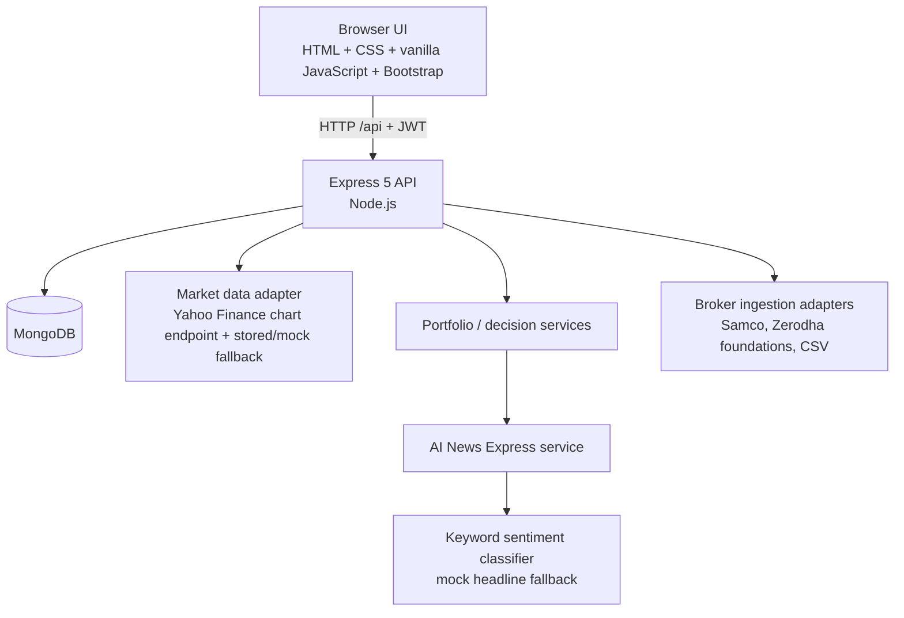
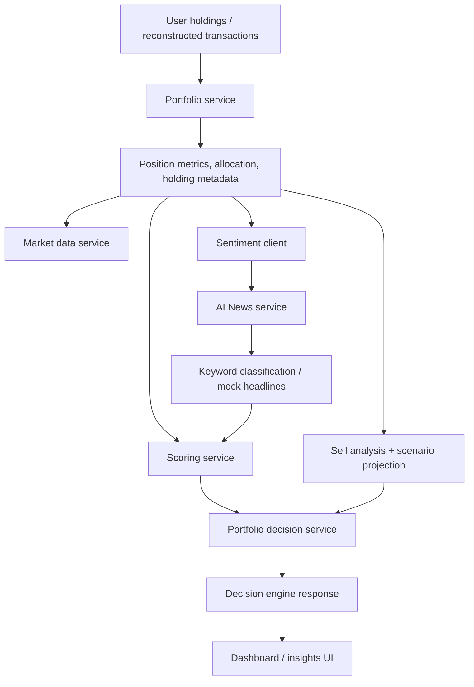

# Stock Insights — Architecture

**Last reviewed:** 10 November 2026  
**Status:** Current-state architecture, based on the repository implementation. This document distinguishes implemented behavior from future design.

## 1. Product boundaries

Stock Insights is an investment analytics and decision-support application. It is not a broker, order execution platform, or automated investment adviser. Deterministic backend services calculate metrics and decisions; the browser presents them. AI/news functionality is an auxiliary explanation/sentiment input and must not be treated as an authoritative financial signal.

## 2. Runtime topology

The primary API serves the static browser application from `public/` and mounts API routes under `/api`. The AI News service is a separately started Express process (default port 4001); the primary API calls it over HTTP with a configured timeout and neutral fallback.

## 3. Technology actually present

| Concern | Current implementation |
|---|---|
| Runtime | Node.js, CommonJS |
| HTTP | Express 5 |
| Browser UI | Static HTML, CSS, vanilla JavaScript, Bootstrap CDN |
| Persistence | MongoDB via Mongoose |
| Authentication | JWT bearer tokens; browser stores token in localStorage |
| Market data | Yahoo Finance chart endpoint adapter; stored and mock fallbacks |
| Broker ingestion | Provider interface/factory, Samco and Zerodha broker adapters, generic/Samco/Zerodha CSV adapters |
| Fundamentals | Screener XLSX parser/importer, Mongoose company fundamentals, deterministic analysis and score adapter |
| News sentiment | Separate Express service; current classifier is keyword-based and its default headline source is mock data |
| Tests | Node.js built-in `node:test` |
| API contract | OpenAPI YAML (coverage must be kept in parity with all routes) |

React, Jest, Kafka, Redis, and a production LLM/news ingestion pipeline are not part of the current runtime implementation.

## 4. Primary API request path

1. Browser page scripts call the shared `StockInsightsApp.apiFetch` helper.
2. Express mounts route groups: health, auth, debug, stocks, portfolio, import, broker, and transactions.
3. Protected route groups apply JWT authentication middleware. Request validation is applied to selected stock and portfolio calculation endpoints.
4. Controllers delegate to domain services.
5. Services use Mongoose models for user, stock, transaction, broker connection, and company fundamental data.
6. Responses use the API success/error envelope and are rendered by browser page modules.

## 5. Portfolio analytics and decision flow

- `portfolio.service` calculates portfolio and position metrics.
- `market-data.service` resolves current prices and records whether the value came from live, stored, or mock data. Mock data must remain visibly distinguishable from a live quote.
- `scoring.service` calculates normalized components using the current configured weights of 35% / 25% / 15% / 25%, with dynamic weight shifts. Important naming caveat: `technicalScore` currently comes from coarse unrealized P/L percentage bands, not chart indicators such as moving averages or RSI; `fundamentalScore` currently comes from holding-duration bands, not company financial statements. Sentiment is keyword/mock-backed and portfolio signals are allocation/P&L rules. The present score is therefore a heuristic portfolio-position score, not a full technical/fundamental stock-quality model.
- `fundamental-analysis.service` contains deterministic non-financial-company assessment logic, and `screener-import.service` plus `fundamental-data.service` import and persist Screener workbook data.
- **These fundamental modules are not currently called by the live portfolio/decision request path.** Repository-wide call-site inspection found no application service invoking `analyzeFundamentals` or `buildFundamentalScoreAdjustment`. The current `scoring.service.getFundamentalScore` is based on holding duration, not company financial statements. Treat fundamental analysis as an offline/imported foundation, not a live portfolio feature.
- `fundamental-score-adapter.service` produces a capped adjustment (±1.5) and signals, but it is currently standalone and not wired into final scoring.
- `portfolio-decision.service` is the authoritative position action/explanation builder. The decision engine exposes a compatibility suggestion derived from that decision to avoid conflicting UI actions.
- Financial-company assessment is explicitly not implemented; it returns unknown/context-required signals rather than applying industrial-company ratios.

## 6. Portfolio ingestion and transaction reconstruction

The ingestion layer separates provider access from canonical transaction normalization:

- Provider factory selects broker or CSV adapters.
- Provider adapters fetch/parse raw rows and normalize them into the shared transaction shape.
- Ingestion service validates rows, identifies duplicates by broker/external transaction ID, and inserts accepted transactions.
- Holdings are reconstructed from transaction history using FIFO cost-basis logic.
- If a broker returns holdings but no historical trades, synthetic bootstrap transactions may be created. Such rows are marked synthetic/bootstrap and acquisition-date confidence must remain explicit.
- Samco-specific historical trade sync and bootstrap migration endpoints exist.
- Zerodha adapter foundations exist; supported authentication and historical retrieval behavior should be verified against current broker API requirements before advertising production-ready sync.

Broker credentials are currently persisted in the broker connection document as a Mixed field. They are omitted from JSON serialization, but this is not encryption at rest. This is a release-blocking security concern for production credentials.

## 7. Data and model boundaries

- `User`: account identity and password hash.
- `Stock`: user-owned position records.
- `Transaction`: normalized executed trade history and synthetic bootstrap entries.
- `BrokerConnection`: broker state, sync cursor, error metadata, and currently stored credentials.
- `CompanyFundamental`: imported company metrics and source metadata.

MongoDB is required by the main API at startup. No migration framework or formal schema-version migration process was identified in the current repository inventory; schema evolution should be documented and tested as models change.

## 8. Security and operational controls — current gaps

The following are observed implementation risks, not merely future enhancements:

1. JWT secret has a hard-coded development fallback. Production startup must fail closed when a strong secret is not configured.
2. Broker credentials are stored as plaintext Mixed data in MongoDB. Encrypt with managed keys or replace storage with a secure token vault; implement rotation and redaction.
3. JWT is stored in browser localStorage, making token theft possible if an XSS vulnerability is introduced. Consider secure, HttpOnly, SameSite cookies and CSRF controls.
4. CORS is currently unrestricted via `cors()`; restrict allowed origins by environment.
5. No rate limiting was identified on authentication endpoints.
6. Debug/sync routes and verbose broker logs require production access controls and sensitive-data redaction review.
7. Market-data mock fallback must never be mistaken for a real quote; preserve source and timestamp in every relevant response.
8. AI News sentiment is heuristic/mock-backed and must not be represented as verified current-news analysis.

## 9. Testing and delivery

The repository uses `node:test` via `npm test`. Unit coverage spans classification, decision consistency, fundamentals, scoring, market data, ingestion, parsing, scenario, sell analysis, transactions, and UI formatting. The Samco Excel integration test has a separate npm script.

Important release requirement: the previous `.gitignore` ignored most of `tests/*`, so several tests ran locally but were not part of Git history. The ignore rule must be corrected and all intended test files committed. Passing local tests alone is not proof of a reproducible clone until this is fixed.

## 10. Architecture decisions to preserve

- Keep deterministic calculations authoritative; AI is an optional explanatory/enrichment dependency.
- Keep broker-specific parsing and API behavior behind provider adapters.
- Normalize broker data before persistence and keep idempotency/deduplication explicit.
- Preserve source, timestamp, and confidence/provenance for market and imported data.
- Keep one authoritative portfolio action and explanation per position.
- Do not infer missing acquisition dates or fundamental metrics as factual values.
